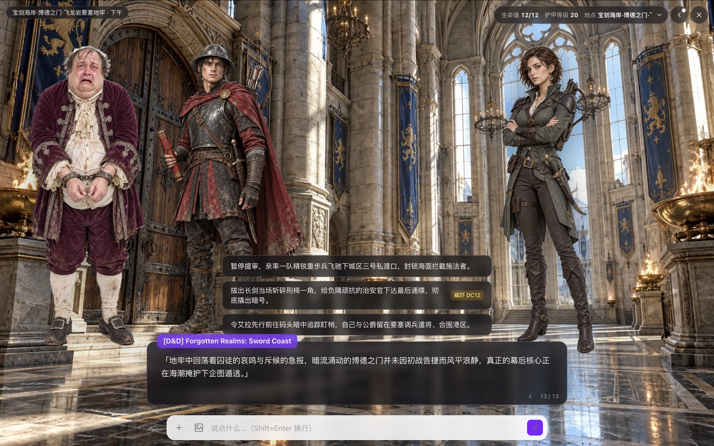
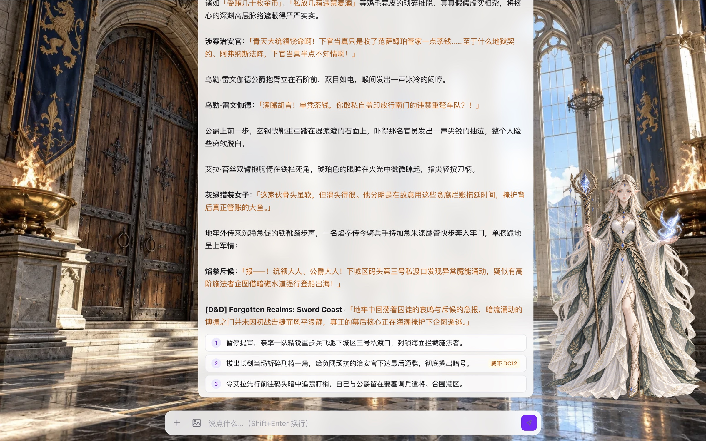
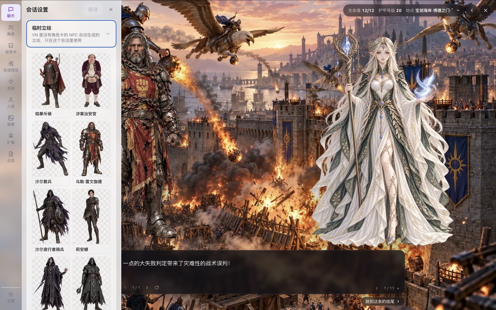
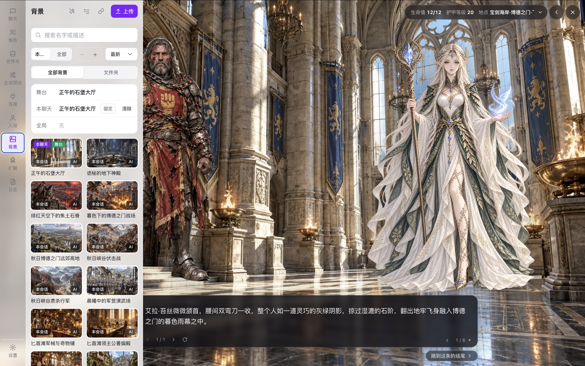
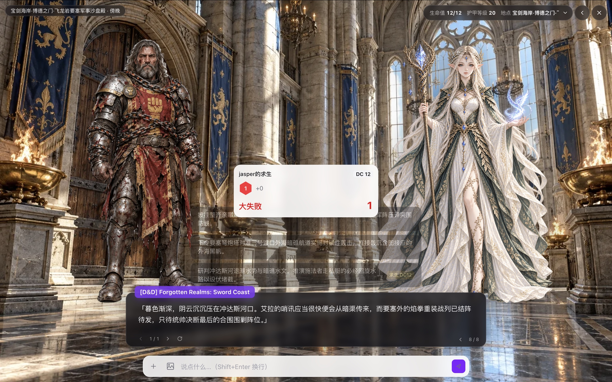
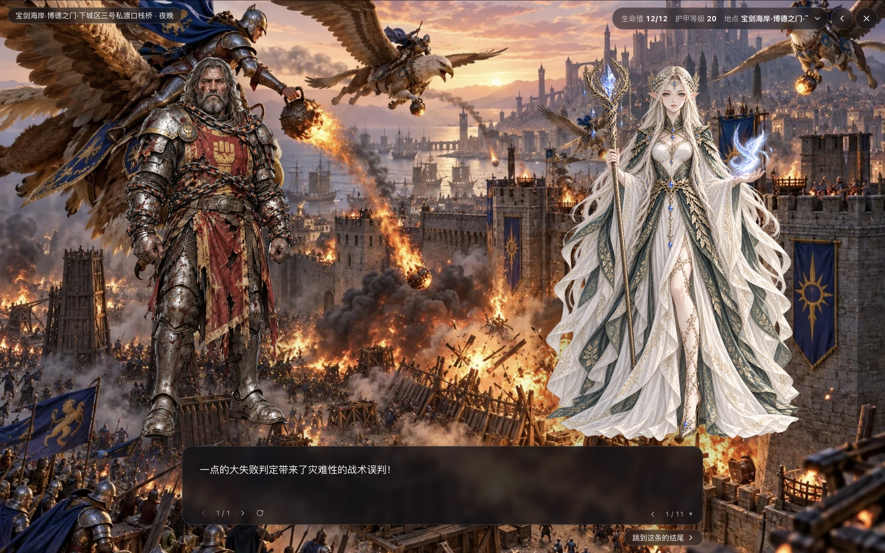
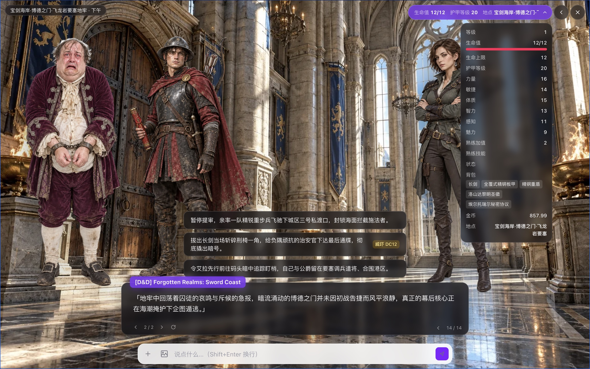

<div align="center">

# NoBot

**An AI roleplay platform compatible with the SillyTavern ecosystem that presents conversations as a visual novel.**

The model writes the narrative and NoBot stages it: sprites, backgrounds, CGs, music and line-by-line voice acting are driven by stage directions, and branching choices are left to the user.

[简体中文](README.md) · English

[](LICENSE)




<sub>Screenshot of a running instance: a D&D campaign card in VN mode with three characters on stage, a background generated for the scene, and a choice with an Intimidation DC 12 check</sub>

</div>

## Highlights

<table>
<tr>
<td width="50%" valign="top">

#### 🎭 Performance driven by stage directions
The model emits stage directions, and entrances, blocking, expressions, scene changes, CGs, BGM and branching choices are presented line by line.

</td>
<td width="50%" valign="top">

#### 🎨 Automatic sprites and backgrounds
Generate full expression sets with automatic cutouts; when a new scene has no matching background, one is generated and named by a vision model.

</td>
</tr>
<tr>
<td valign="top">

#### 🗣️ Multi-character voice acting
Each character has its own voice, with gender-based assignment as a fallback; delivery and sound markers are converted to each engine's capabilities instead of being read aloud.

</td>
<td valign="top">

#### 👥 Ordered group performance
Replies within a round are performed and read in order, with optional reading while generating.

</td>
</tr>
<tr>
<td valign="top">

#### 🎲 Rule-enforced tabletop
Dice rolls and checks are resolved by NoBot and cannot be altered by the model; HP, inventory and other state roll back with the message tree.

</td>
<td valign="top">

#### 🌳 Uninterrupted generation
Generation runs on the server and continues after a refresh or reconnect; a virtualized list keeps long chats responsive.

</td>
</tr>
<tr>
<td valign="top">

#### 🔍 Explainable lorebooks
The prompt preview lists why each entry was activated or skipped, making issues easy to trace.

</td>
<td valign="top">

#### 🧩 Hot-pluggable extensions
Install, update and uninstall extensions from Git without restarting, with required permissions listed before enabling.

</td>
</tr>
</table>

## Key features

### 🎭 A visual novel driven by stage directions

The model writes stage directions inline (shorthand or XML format, with MVU variable syntax supported). They are hidden in the chat view and performed line by line in the VN view:

- **Entrances and blocking**: characters enter, exit and change expressions and outfits, and the remaining characters re-center automatically; NPCs without sprites can receive temporary ones
- **Scenes and CGs**: scene directions switch the background; a `<cg>` direction produces a full-screen illustration that is added to the character's CG gallery
- **Choices and status**: choices at the end of a reply are presented as selectable options, with the skill and difficulty shown for checks; affection stages, HP and other stats appear in the HUD, with value changes shown as floating text
- **Complete VN controls**: ADV / NVL layouts, typewriter effect, auto-play, skip (optionally limited to read text), backlog with "replay from here", rewind, save / load with thumbnails, and a cinema mode with letterboxing and subtitles only
- **Ordered group performance**: when several characters reply in one round, the replies are performed one after another, including while they are still generating
- **Play presets**: built-in Chat, Companion, Galgame, RPG and D&D 5e presets; directive format, layout, HUD and choice style are all configurable

<div align="center">

<br><sub>The same conversation in chat view: directives hidden, speakers labeled, a sprite shown at the side</sub>
</div>

### 🎨 Automatic sprite and background generation

- **Sprites**: generate a full expression set in one batch (using the first image as a reference for consistent appearance), with multiple outfits and drag-and-zoom placement; SillyTavern sprite packs can be imported directly
- **Cutouts**: three methods are available — a basic algorithm, transparent output from the image service (ComfyUI requires the corresponding nodes), or a local matting model downloaded when selected; existing sprites can be processed again
- **Backgrounds**: when the story enters a new scene, the library is matched by name and description first; if nothing matches, a new background is generated for the scene, and a vision model writes its name and description for future matching
- **Background library**: folders, batch actions, chat and global layers, and pinning to prevent scene directions from replacing a background
- **Image services**: OpenAI-compatible APIs (including gpt-image and Gemini image models), ComfyUI custom workflows, OpenRouter and A1111 / Forge; each profile can specify its own image backend and style

<div align="center">

<br><sub>NPCs that appear in the story without a character card receive automatically generated transparent sprites, used only within the current chat</sub>
</div>

<div align="center">

<br><sub>Every image in this library was generated and named automatically during a campaign; the top card shows the background currently used by the stage</sub>
</div>

### 🗣️ Multi-character voice and expressive delivery

- **Nine TTS engines**: browser speech, Edge, OpenAI-compatible, ElevenLabs, Fish Audio, MiniMax, Volcengine, GPT-SoVITS and CosyVoice (official API or a compatible gateway); Fish Audio and the CosyVoice gateway can fetch the user's saved or liked voices
- **Voice assignment**: voices can be assigned per character card, group member and NPC; unassigned characters receive a voice from the pool **by gender**, which can be inferred from the card
- **Expressive delivery**: emotion, intensity, whisper / shout, pauses and fifteen sounds such as laughter, sighs, gasps and sobs, converted to each engine's supported controls (ElevenLabs audio tags, Fish emotion markers, CosyVoice instructions, MiniMax interjections and others); markers an engine does not support are removed rather than read aloud
- **Delivery director**: when the model provides no delivery hints, a delivery director can annotate each line from context
- **Playback modes**: manual reading, auto-reading new replies, line-by-line VN voicing and reading while generating; group replies are read in order; on mobile browsers that block autoplay, a prompt asks the user to tap to resume

### 🎲 Rule-enforced tabletop support

- Personas and character cards support D&D 5e sheets (abilities, proficiencies, expertise, saves, HP, AC), which are written into exported cards
- The model requests dice rolls and ability / skill checks through tool calls, and results are displayed as dice cards; **choices with checks are rolled by NoBot before sending**, so the model must accept the outcome
- A `<combat>` direction starts an encounter, showing an initiative bar and HP at the top of the VN view
- All state is recorded on the message tree; regenerating or switching branches restores HP and inventory to the corresponding point

<table>
<tr>
<td width="50%"></td>
<td width="50%"></td>
</tr>
<tr>
<td align="center"><sub>After a choice with a check is selected, NoBot rolls the dice and presents the result on stage (here, a critical failure on a Survival check)</sub></td>
<td align="center"><sub>The model has to accept the outcome: the next scene turns into a siege caused by the tactical blunder, and the background changes with it</sub></td>
</tr>
</table>

<div align="center">

<br><sub>Tabletop status panel: abilities, HP, armor class, inventory, gold and location</sub>
</div>

### 🌳 Reliable conversation management

- **Message tree**: regenerate, switch between candidate replies, edit, delete (together with later branches) and branch any message into a new chat; reordering messages creates a new branch and keeps the original order
- **Uninterrupted generation**: generation runs on the server, so replies continue to appear after a page refresh, a chat switch or a reconnect
- **Long-conversation performance**: a virtualized message list that loads earlier history on demand

## SillyTavern compatibility and general features

### 📚 SillyTavern data compatibility

- Import character cards (PNG / JSON), lorebooks, generation presets, sprite packs and quick replies; exported cards can be used in SillyTavern
- Covers every SillyTavern Chat Completion source: native protocols for Claude / Gemini / Vertex AI / Azure, plus more than thirty preconfigured providers with their API differences handled automatically
- Sampler settings, prompt manager (drag to reorder, depth injection, generation-type triggers), utility prompts, message post-processing, continue and response prefill
- Lorebooks: keywords (regex supported), optional filters, constant, probability, recursion, inclusion groups, delay / sticky / cooldown, character filters, outlets and vector matching across eight insertion positions, attachable to global, character, persona or chat scope

### 💬 Chat

- Streaming, reasoning display, stop, continue and impersonate; pressing Enter on an empty input lets the character continue
- Group chats with natural, list, round-robin and manual turn order, forced speakers and muted members
- Per-chat persona, generation preset, connection, chat lorebook, voice settings and author's note
- Message exclusion, bookmarks, multi-select actions, slash commands (`/roll 2d6`, `/bg`, `/imagine` and others, chainable with `|`) and quick reply buttons
- Images can be sent to vision models, or converted to text descriptions for models without vision support
- Translation (model, Google, DeepL, DeepLX, LibreTranslate, Lingva) that preserves the original text and keeps stage directions functional
- Chat summaries, trash bin, multiple personas, and request logs accessible from any message

### 🏠 Deployment and multiple users

- Runs as a single process or via `docker compose`, and supports mobile browsers
- Multi-user: administrators can create users, reset passwords, and disable or delete accounts under **Settings → Account → Users**; each user's characters, chats and API keys are isolated
- Profiles combine connection, model, generation preset, regex and image settings, and can be set as default, bound to a character or switched per chat
- Extensions: backends can register macros, tools, slash commands and routes and participate in prompt assembly, and frontends can add components to UI slots; see `examples/extensions/hello-world`
- Chinese and English interface

## Quick start

Requires [Bun](https://bun.sh) 1.4 or later (macOS: `brew install oven-sh/bun/bun`).

```bash
bun install
NOBOT_ADMIN_PASSWORD='at-least-8-chars' bun run dev   # creates the admin account on first start
```

Open <http://localhost:5173> and sign in as `admin` with the password above. Once the administrator exists, run `bun run dev` directly; set `NOBOT_ADMIN_USERNAME` to use a different administrator username.

Switch the interface language under **Settings**, then configure the items in the sidebar:

1. **Connections**: choose a provider, enter the API key, test the connection and fetch the model list
2. **Personas**: set the user's name in the story (`{{user}}` in character cards)
3. **Characters**: import SillyTavern character cards; embedded lorebooks are imported as well
4. **Chat**: create a chat, set the play preset to Galgame or RPG, and switch to VN mode in the top-right corner

### Production mode

```bash
bun run build   # build the frontend once after each update
bun start       # single process at http://127.0.0.1:3000
```

For access from mobile devices on the local network, run `HOST=0.0.0.0 bun start` and open `http://<computer's LAN IP>:3000`. For public access, deploy an HTTPS reverse proxy (Nginx, Caddy or similar) in front instead of exposing port 3000 directly.

### Docker

```bash
echo "NOBOT_ADMIN_PASSWORD=at-least-8-chars" > .env
docker compose up -d --build
```

By default the service listens on `127.0.0.1:3000` only and stores data in `./data`. To update, pull the new code and run `docker compose up -d --build` again.

Common `.env` variables:

| Variable | Description |
|---|---|
| `NOBOT_ADMIN_USERNAME` / `NOBOT_ADMIN_PASSWORD` | Administrator created on first start; the password variable can be removed afterwards |
| `NOBOT_ADMIN_RESET=1` | Enable temporarily to reset a forgotten password with a new one, then set it back to `0` |
| `NOBOT_BIND_IP` / `NOBOT_PORT` | Host address and port, e.g. `0.0.0.0` / `8080` |
| `TRUST_PROXY=1` | Enable only behind a trusted reverse proxy so login rate limiting sees real client IPs |
| `NOBOT_PROXY` / `NOBOT_NO_PROXY` | Proxy for outbound requests (models, voice and image services) |
| `BUN_IMAGE` / `DEBIAN_MIRROR` / `BUILDKIT_SYNTAX` | Mirror addresses for builds when Docker Hub or Debian repositories are unreachable |

## Data storage

```
data/system.db          accounts and sessions
data/users/<username>/  each user's database, assets, voice cache and extensions
data/models/            model files shared by all users (such as the matting model)
```

To back up, stop the service and copy the entire `data/` directory; use `DATA_DIR` to store data elsewhere. When upgrading from the single-user version, existing data is migrated to the administrator account on first start.

## Not yet supported

- Autonomous group chat (characters continuing the conversation among themselves), importing SillyTavern chat history, video generation
- Other tabletop rule systems (CoC, PF2e, PbtA, custom rules)
- SillyTavern's Text Completion mode (instruct templates and raw completion APIs)

## Development

```bash
bun test              # run all tests
bun run typecheck     # type checks
bun run lint          # Biome
bun run db:generate   # generate a migration after editing apps/server/src/db/schema.ts
bun scripts/mock-llm.ts  # mock model on port 3999 (http://127.0.0.1:3999/v1, key sk-test) for local debugging
```

When ports cannot be opened or network access is unavailable, run the tests with mocks:

```bash
MOCK_LLM_FETCH=1 EXT2_FETCH_MOCK=1 IMG3_FETCH_MOCK=1 BACKGROUND_FETCH_MOCK=1 TTS_FETCH_MOCK=1 bun test
```

```
packages/shared   types and Zod schemas shared by client and server (the API contract)
packages/core     pure logic: prompt assembly, lorebooks, macros, message tree, VN stage directions, voice delivery
apps/server       Bun + Hono backend: accounts, database, API (see apps/server/API.md), generation, extensions
apps/web          React 19 frontend
```

The `fixtures/` directory contains sample character cards, a lorebook and a generation preset.

## License

[GNU AGPL-3.0](LICENSE). Free to use, modify and distribute; if a modified version is offered to others as a network service, its source code must be made available.

NoBot is not affiliated with [SillyTavern](https://github.com/SillyTavern/SillyTavern). It is compatible with SillyTavern's data formats and draws on its feature design.
